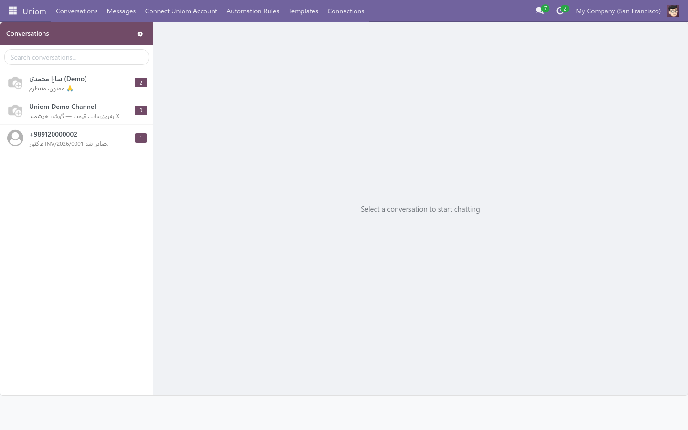
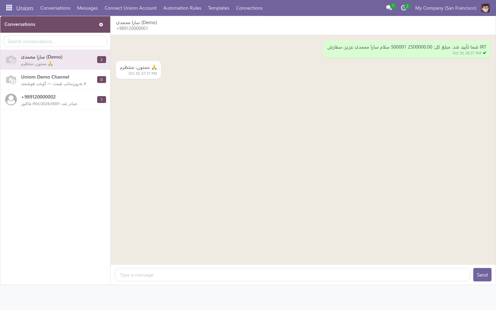
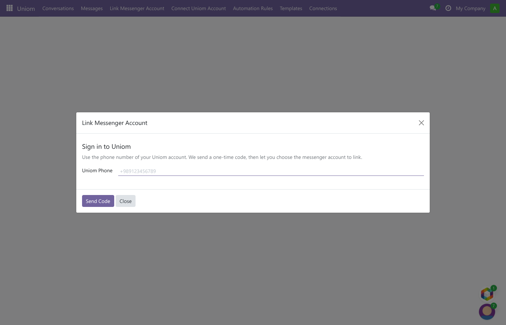
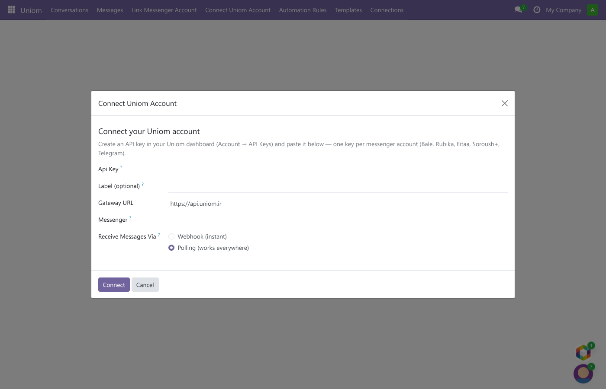
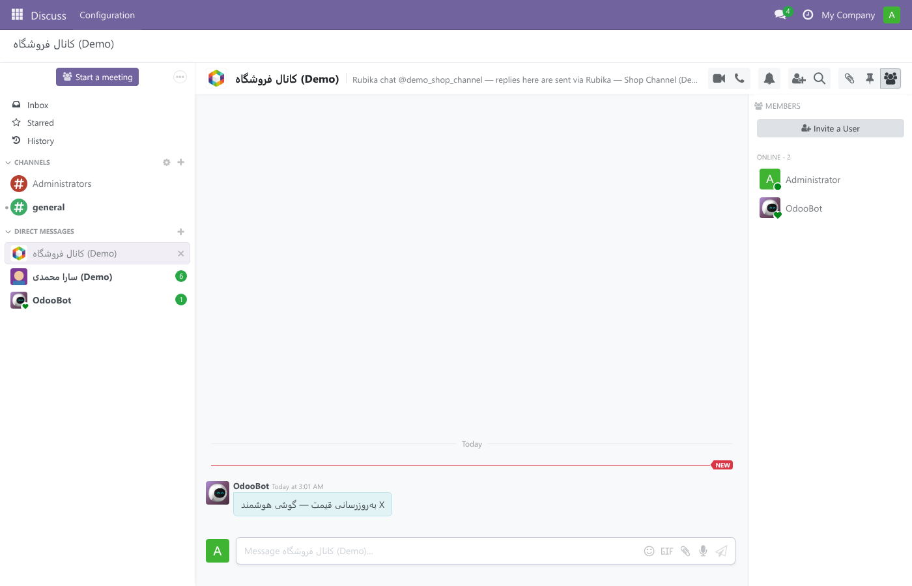
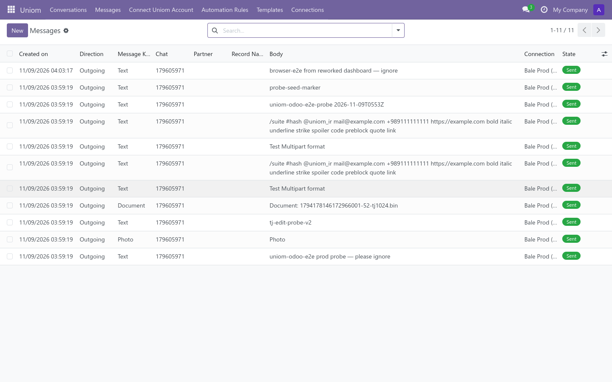
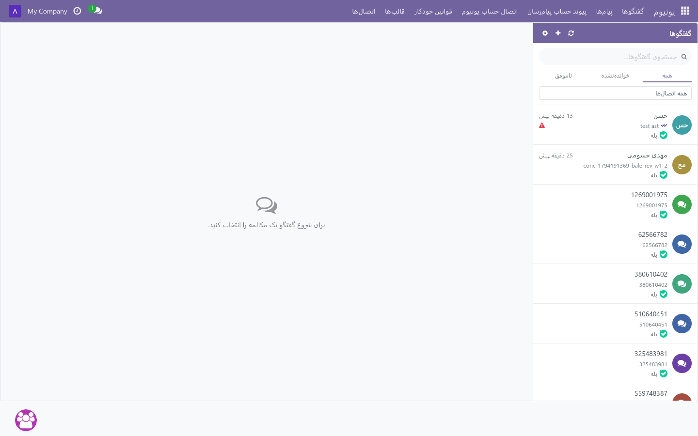

# Uniom Messaging Gateway for Odoo

**[فارسی](README.md) | English**

Connect Odoo to the messengers your customers actually use — **Bale,
Rubika, Eitaa, Soroush+ and Telegram** — through the
[Uniom](https://uniom.ir) gateway. When an order is confirmed, an invoice
is issued, a payment lands or a delivery ships, the customer gets a
message on their phone; your channel stays in sync with product news and
price updates — including **editing the price post in place**.

Works with Odoo **19.0** (Community & Enterprise); same features on the
`18.0` branch, `17.0` stays on the previous release. The `19.0` branch is
**verified on a real installation**: full test suite green
(`--test-tags /uniom_connector`, 106/106 with `fa_IR` loaded), complete
Persian/Arabic translations (580/580 user-facing terms per language), live
validation against api.uniom.ir
(send/receive/polling/media/presence/history/Discuss/linking) and store
screenshots captured from the live UI.

```
Sale confirmed ────┐
Invoice posted ────┤
Payment in ────────┼──▶ uniom.message queue ──▶ api.uniom.ir ──▶ customer phone
Delivery done ─────┤     (retry + backoff)       Bot API        / @channel
Price changed ─────┘                                            (editMessageText)
```















## Zero Setup

After install you get **Conversations** (the messenger UI), seven
ready-made automation rules (three enabled), templates in **English,
Persian and Arabic**, and the message log. The only remaining step is
connecting:

1. Install the module, then link a messenger account from inside Odoo
   with **Uniom ← Link Messenger Account** (Uniom phone+OTP sign-in,
   then messenger phone+code/two-step/bot-token — the Uniom panel flow;
   the API key is minted and the connection created for you).
   Prefer a key? Paste a `uniom_...` key from your Uniom dashboard
   (account ← API keys) with **Uniom ← Connect Uniom Account**.
2. Pick the messenger and the inbound mode (webhook/polling) and press
   **Connect** — the gateway answers with the account name and the
   connection is live.

Rules only fire when a connection exists, so installing the module never
surprises anyone with a send. Nothing else is needed: customer mobile
numbers are canonicalized automatically (`09123456789` ←
`+989123456789`).

## Features

| Area | What you get |
| --- | --- |
| Conversations | WhatsApp-style two-pane messenger: unread badges, last-seen status, per-messenger icons (Bale/Rubika/Eitaa/Soroush+/Telegram), media bubbles (photo/video/file/voice/location/poll), day dividers, history loading, optimistic sends with retry/cancel, live bus updates with polling fallback, own-bubble side configurable in Settings |
| Setup | **Link Messenger Account** wizard — Uniom phone+code sign-in then messenger phone+code/two-step/bot-token linking (the panel flow, inside Odoo); or **Connect Uniom Account** by pasting an API key. Both: messenger + inbound mode (webhook/polling), gateway-verified account, conversations seeded from getDialogs |
| Events | Quotation sent · sale confirmed · invoice posted (with PDF attached) · payment received · delivery done · product published · **product price change (edits the earlier channel post)** |
| Recipients | Customer mobile / explicit chat id, per-contact opt-out, plus manual destinations (`@channel`, mobiles, numeric ids) |
| Templates | `{{ object.field }}` placeholders (same engine as Odoo mail templates), per-language template picked by the customer's language |
| Queue | Immediate send with retry cron (every 5 min), exponential backoff, honors `retry_after`, 5xx retries, **no retry on 504 "outcome unknown"** (Uniom API policy), full per-message error log, failure reminder on business records |
| Inbound | Webhook (`/uniom/webhook/<connection>` with secret-token verification) **or** getUpdates polling (1-minute cron, durable offset, conflict backoff) — media downloads to attachments, contact matching, chatter posts with deep links into the thread |
| Discuss | Every conversation mirrors into a native Discuss channel (direct messages); replies typed in Discuss go out through the Uniom queue with a loop guard |
| Manual send | **Send via Uniom** button on contacts, sale orders, invoices and deliveries (composer with recipient list + optional PDF) |
| Access | *Uniom user* and *Uniom manager* groups, multi-company connections and record rules |
| Languages | UI translated to Persian (fa_IR) and Arabic (ar_001); RTL follows the Odoo-native direction when the user switches to Persian/Arabic |

## Configuration Notes

* **Gateway address**: inside Iran `https://api.uniom.ir`, outside Iran
  `https://api.uniomi.ir`. Only public HTTPS hosts are accepted
  (localhost/private addresses are rejected and redirects are never
  followed).
* **Webhook (inbound)**: your Odoo must be reachable on a public HTTPS
  URL. Press *Register Webhook* on the connection form — the module
  calls `setWebhook` with a generated `secret_token`, and Uniom later
  pushes updates with the `X-Telegram-Bot-Api-Secret-Token` header,
  verified on every call.

## Install

```bash
git clone https://github.com/Uniom-ir/odoo-connector   # or your mirror
cd odoo-connector
# symlink or copy uniom_connector/ into your addons path, then:
odoo-bin -d mydb -i uniom_connector
```

No Python package beyond `requests` is needed (shipped with Odoo).

## Development & Tests

```bash
# unit tests inside Odoo 19.0
odoo-bin -d test --test-enable --stop-after-init \
    -i uniom_connector --test-tags /uniom_connector --without-demo=all \
    --load-language en_US,fa_IR,ar_001

# regenerate translation templates
python3 scripts/gen_i18n.py
```

CI (`.github/workflows/ci.yml`) runs the full suite on Odoo 17/18/19 with
`fa_IR`/`ar_001` loaded. `screenshots.yml` (via workflow_dispatch)
boots Odoo with demo data and captures the store screenshots with
Playwright.

## License

LGPL-3 (see the `LICENSE` file). © Uniom — https://uniom.ir
