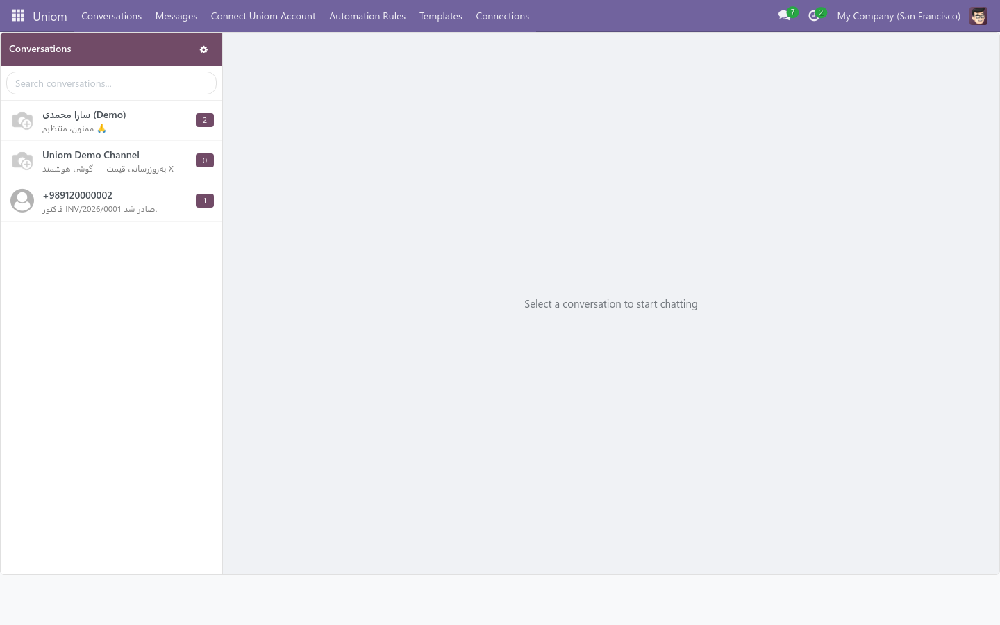
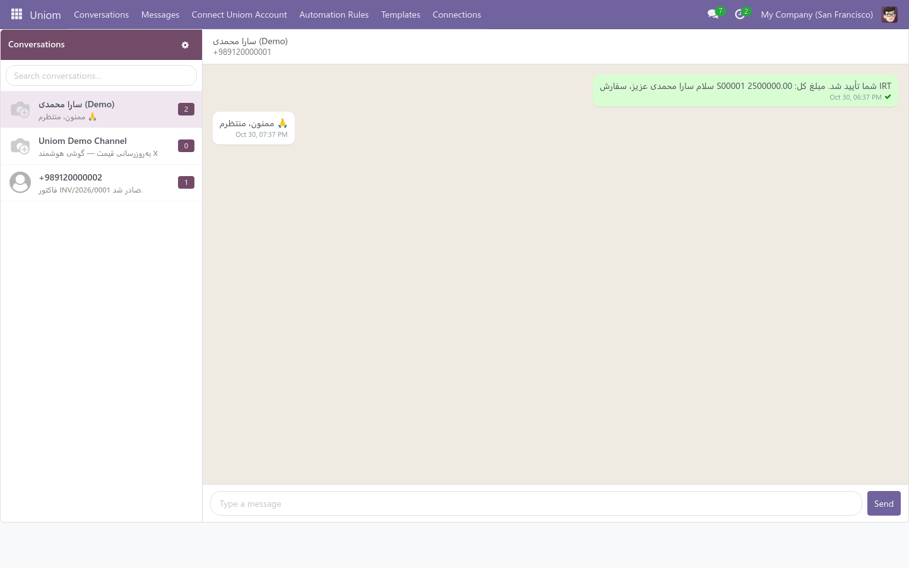
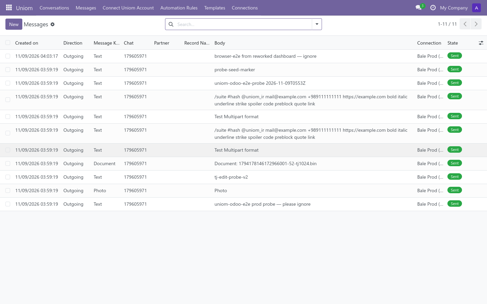
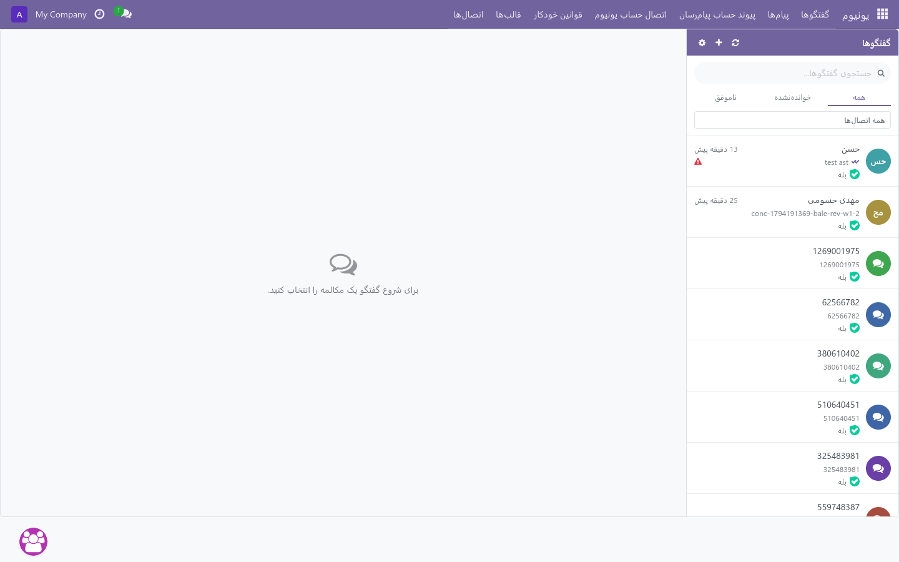

# Uniom Messaging Gateway for Odoo

Connect Odoo to the messengers your customers actually use — **Bale, Rubika,
Eitaa, Soroush+ and Telegram** — through the [Uniom](https://uniom.ir)
gateway. When an order is confirmed, an invoice is issued, a payment lands or
a delivery ships, the customer gets a message on their phone; your channel
stays in sync with product news and price updates — including **editing the
price post in place**.

Works with Odoo **18.0 and 17.0** (Community & Enterprise), one branch per
version exactly how the Odoo Apps store expects it (this `18.0` branch is
the main line; the `17.0` branch carries the same features). Both branches
are **verified on real installations**: full test suite green
(`--test-tags /uniom_connector`, 43/43) on Odoo 18.0 and 17.0, demo data
and Persian/Arabic translations loaded and checked, and the store
screenshots captured from the live UI.

```
Sale confirmed ──┐
Invoice posted ──┤
Payment in ──────┼──▶ uniom.message queue ──▶ api.uniom.ir ──▶ customer phone
Delivery done ───┤        (retry + backoff)      Bot API        / @channel
Price changed ───┘                                        (editMessageText)
```










## Out of the box

After install you get **Conversations** (messenger UI), seven ready automation
rules (five active), templates in **English, Persian and Arabic**, and the
message log. The only thing to do is connect:

1. Install the module, then **Uniom → Connect Uniom Account** (or the button
   in Settings).
2. Paste the `uniom_...` API key from your Uniom dashboard
   (Account → API Keys — one key per messenger account) and press
   **Connect** — the gateway replies with the account name and the
   connection is live.

Rules fire only when an active connection exists, so installing the module
never surprises anyone with sends. Nothing else is required: customer phone
numbers are canonicalized automatically (`09123456789` → `+989123456789`).

## Features

| Area | What you get |
| --- | --- |
| Conversations | Messenger UI à la WhatsApp connectors: every inbound/outbound message opens a thread (kanban of conversations, per-thread history with IN/OUT badges, **reply box that sends through Uniom**) |
| Setup | **Connect Uniom Account** wizard — paste one API key, press Connect, the gateway confirms the account name. No configuration pages needed |
| Events | Quotation sent · sale confirmed · invoice posted (PDF attached) · payment received · delivery done · product published · **product price changed (edits the previous channel post)** |
| Recipients | Customer's phone / explicit chat id, per-contact opt-out, plus manual destinations (`@channel`, phones, numeric ids) |
| Templates | `{{ object.field }}` placeholders (same engine as Odoo mail templates), per-language templates picked by customer language |
| Queue | Immediate send with retry cron (every 5 min), exponential backoff, `retry_after` respected, 5xx retried, **504 "outcome unknown" never retried** (Uniom API policy), full error log per message |
| Inbound | Webhook endpoint `/uniom/webhook/<connection>` with secret-token verification, contact matching by phone/chat id, auto-contact creation, messages logged and shown on the chatter |
| Manual send | **Send via Uniom** button on partners, sale orders, invoices and deliveries (composer with recipient list + optional PDF) |
| Access | *Uniom User* and *Uniom Administrator* groups, multi-company connections and record rules |
| Languages | UI translated to Persian (fa_IR) and Arabic (ar_001); RTL rendering is native in Odoo once the user language is fa/ar |

## Configuration notes

* **Gateway URL**: `https://api.uniom.ir` in Iran, `https://api.uniomi.ir`
  from abroad. Only public HTTPS hosts are accepted (localhost/private
  addresses are refused, and redirects are never followed).
* **Webhook (inbound)**: your Odoo must be reachable on a public HTTPS URL.
  Press *Register Webhook* on the connection form — the module calls
  `setWebhook` with a generated `secret_token` and Uniom then posts updates
  with the `X-Telegram-Bot-Api-Secret-Token` header, verified on every call.
* **Quotas**: free Uniom plans cap at 30 req/min and 1000 messages/month;
  the queue respects `429 + retry_after` automatically.

## Installation

```bash
git clone https://github.com/uniom/uniom-odoo   # or your mirror
cd uniom-odoo
# symlink or copy uniom_connector/ into your addons path, then:
odoo-bin -d mydb -i uniom_connector
```

No external Python packages beyond `requests` (already shipped with Odoo).

## Development & tests

```bash
# unit tests inside Odoo 18.0
odoo-bin -d test --test-enable --stop-after-init \
    -i uniom_connector --test-tags /uniom_connector --without-demo=all \
    --load-language en_US,fa_IR,ar_001

# regenerate translation templates
python3 scripts/gen_i18n.py
```

CI (`.github/workflows/ci.yml`) runs the full suite on Odoo 18 with
`fa_IR`/`ar_001` loaded. `screenshots.yml` (workflow_dispatch) boots Odoo
with demo data and captures the store screenshots with Playwright.

## License

LGPL-3 (see `LICENSE`). © Uniom — https://uniom.ir

---

## فارسی — راهنمای سریع

اتصال اودو به پیام‌رسان‌های **بله، روبیکا، ایتا، سروش‌پلاس و تلگرام** از
طریق دروازه [یونیوم](https://uniom.ir):

1. ماژول را نصب کنید و به مسیر **یونیوم ← اتصال‌ها ← جدید** بروید.
2. کلید API (`uniom_...`) را از داشبورد یونیوم (حساب ← کلیدهای API) کپی کنید.
3. دکمه **تست اتصال** را بزنید تا نام حساب متصل تأیید شود.

بعد از آن، این رویدادها به‌صورت خودکار به شماره موبایل مشتری (یا کانال
شما) پیام می‌فرستند: تأیید سفارش، ثبت فاکتور (با پیوست PDF)، دریافت
پرداخت، ارسال مرسوله، محصول جدید و **تغییر قیمت (با ویرایش پیام قبلی
کانال)**. پیام‌ها با احترام به محدودیت نرخ یونیوم در صف ارسال و تلاش
مجدد قرار می‌گیرند و همه‌چیز در لاگ پیام‌ها قابل پیگیری است.

رابط کاربری به فارسی و عربی ترجمه شده و راست‌چین است؛ کافی است زبان
کاربر فارسی/عربی باشد.
