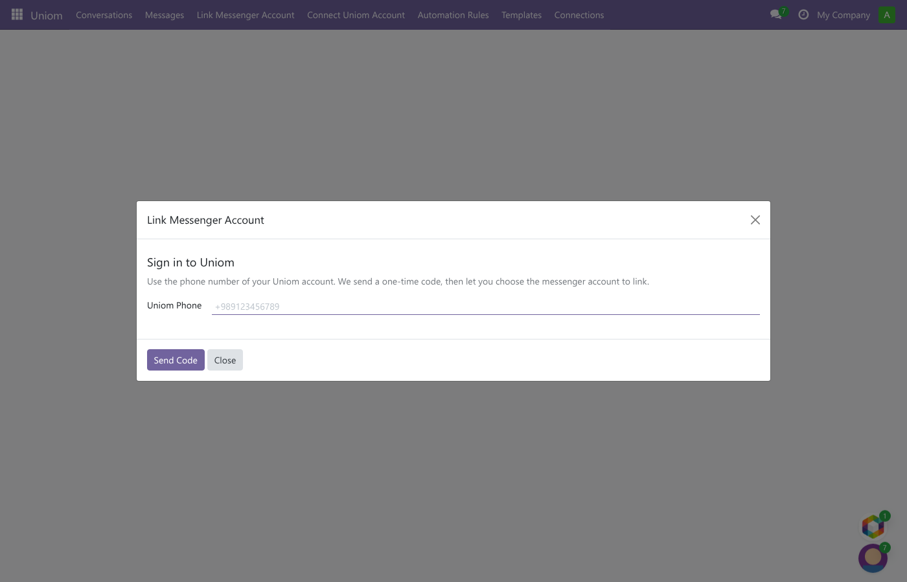
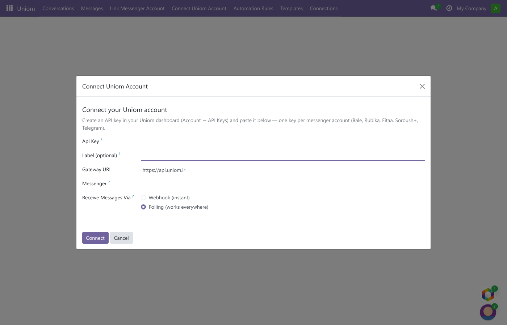
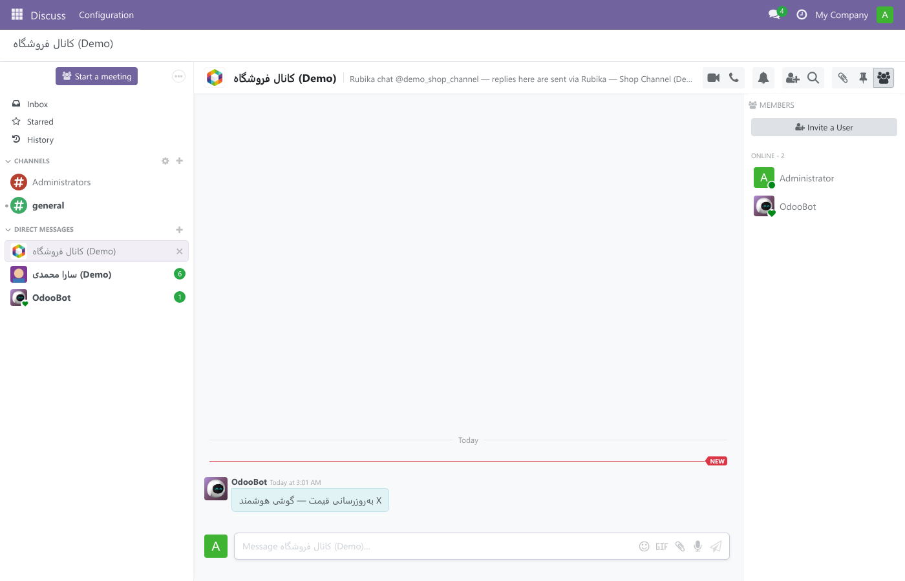

# درگاه پیام‌رسانی یونیوم برای اودو

**[English](README.en.md) | فارسی**

اودو را به پیام‌رسان‌هایی که مشتریان شما واقعاً استفاده می‌کنند وصل کنید —
**بله، روبیکا، ایتا، سروش‌پلاس و تلگرام** — از طریق دروازه
[یونیوم](https://uniom.ir). وقتی سفارشی تأیید شود، فاکتوری صادر شود، پرداختی
برسد یا مرسوله‌ای ارسال شود، مشتری روی گوشی خودش پیام می‌گیرد؛ کانال شما هم
با اخبار محصولات و به‌روزرسانی قیمت‌ها همگام می‌ماند — از جمله **ویرایش
پیام قیمت در جای خودش**.

با اودو **19.0** (Community و Enterprise) کار می‌کند (همان امکانات روی
شاخه `18.0`؛ شاخه `17.0` روی نسخه قبلی می‌ماند). شاخه `19.0` **روی نصب واقعی
راستی‌آزمایی شده**: مجموعه تست کامل سبز (`--test-tags /uniom_connector`،
106/106 با `fa_IR` لودشده)، ترجمه‌های فارسی/عربی کامل (580/580 عبارت کاربری برای
هر زبان)، اعتبارسنجی زنده در برابر api.uniom.ir (ارسال/دریافت/نظرسنجی/
رسانه/حضور/سابقه/Discuss/پیوند) و اسکرین‌شات‌های فروشگاه گرفته‌شده از
رابط زنده.

```
تأیید فروش ──────┐
ثبت فاکتور ──────┤
دریافت پرداخت ───┼──▶ صف uniom.message ──▶ api.uniom.ir ──▶ گوشی مشتری
انجام تحویل ─────┤     (تلاش مجدد + backoff)   Bot API      / @channel
تغییر قیمت ──────┘                                        (editMessageText)
```









## بدون هیچ تنظیمی

بعد از نصب، **گفتگوها** (رابط پیام‌رسان)، هفت قانون خودکار آماده (سه فعال)،
قالب‌ها به **انگلیسی، فارسی و عربی** و لاگ پیام‌ها را می‌گیرید. تنها کار
باقی‌مانده اتصال است:

1. ماژول را نصب کنید، بعد با **یونیوم ← پیوند حساب پیام‌رسان** یک حساب
   پیام‌رسان را از داخل اودو پیوند کنید (ورود با تلفن یونیوم ← کد یک‌بارمصرف،
   بعد تلفن پیام‌رسان ← کد/رمز دومرحله‌ای یا توکن ربات — همان فلوِ پنل
   یونیوم؛ کلید API ساخته می‌شود و اتصال برای شما ایجاد می‌شود).
   کلید را ترجیح می‌دهید؟ با **یونیوم ← اتصال حساب یونیوم** یک کلید
   `uniom_...` از داشبورد یونیوم (حساب ← کلیدهای API) بچسبانید.
2. پیام‌رسان و حالت ورودی (وب‌هوک/نظرسنجی دوره‌ای) را انتخاب کنید و
   **اتصال** را بزنید — دروازه با نام حساب جواب می‌دهد و اتصال زنده است.

قوانین فقط وقتی فعال شدن که اتصالی وجود داشته باشد، پس نصب ماژول هیچ‌وقت
کسی را با ارسال غافلگیر نمی‌کند. هیچ چیز دیگری لازم نیست: شماره موبایل
مشتریان خودکار استاندارد می‌شود (`09123456789` ← `+989123456789`).

## امکانات

| بخش | چه می‌گیرید |
| --- | --- |
| گفتگوها | پیام‌رسان دومنظاره به سبک واتساپ: نشان‌های خوانده‌نشده، وضعیت آخرین بازدید، آیکون اختصاصی هر پیام‌رسان (بله/روبیکا/ایتا/سروش‌پلاس/تلگرام)، حباب‌های رسانه (عکس/ویدیو/فایل/صوت/موقعیت/نظرسنجی)، جداکننده روز، بارگذاری سابقه، ارسال خوش‌بینانه با تلاش مجدد/لغو، به‌روزرسانی زنده bus با نظرسنجی پشتیبان، سمت حباب‌های خود قابل تنظیم در تنظیمات |
| راه‌اندازی | جادوگر **پیوند حساب پیام‌رسان** — ورود با تلفن+کد یونیوم و بعد پیوند با تلفن+کد/دومرحله‌ای/توکن ربات (فلوِ پنل، داخل اودو)؛ یا **اتصال حساب یونیوم** با چسباندن کلید API. در هر دو حالت: پیام‌رسان + حالت ورودی (وب‌هوک/نظرسنجی)، حساب تأییدشده توسط دروازه، گفتگوها از getDialogs مقداردهی می‌شوند |
| رویدادها | ارسال پیش‌فاکتور · تأیید فروش · ثبت فاکتور (با پیوست PDF) · دریافت پرداخت · انجام تحویل · انتشار محصول · **تغییر قیمت محصول (ویرایش پیام قبلی کانال)** |
| گیرندگان | موبایل مشتری / شناسه چت صریح، انصراف هر مخاطب، به‌علاوه مقصدهای دستی (`@channel`، موبایل‌ها، شناسه‌های عددی) |
| قالب‌ها | جای‌نگه‌دارهای `{{ object.field }}` (همان موتور قالب‌های ایمیل اودو)، قالب هر زبان بر اساس زبان مشتری انتخاب می‌شود |
| صف | ارسال فوری با کرون تلاش مجدد (هر ۵ دقیقه)، backoff نمایی، رعایت `retry_after`، تلاش مجدد 5xx، **عدم تلاش مجدد 504 «نتیجه نامشخص»** (سیاست Uniom API)، لاگ کامل خطا برای هر پیام، یادآور خرابی روی رکوردهای تجاری |
| ورودی | وب‌هوک (`/uniom/webhook/<connection>` با تأیید secret-token) **یا** نظرسنجی getUpdates (کرون ۱ دقیقه‌ای، آفست ماندگار، backoff تداخل) — دانلود رسانه به پیوست‌ها، تطبیق مخاطب، پست‌های چیتر با پیوند عمیق به رشته |
| Discuss | هر گفتگو در یک کانال بومی Discuss (پیام‌های مستقیم) آینه می‌شود؛ پاسخ‌های تایپ‌شده در Discuss با محافظ حلقه از صف یونیوم ارسال می‌شوند |
| ارسال دستی | دکمه **ارسال با یونیوم** روی مخاطبان، سفارش‌های فروش، فاکتورها و تحویل‌ها (نویسنده با فهرست گیرندگان + PDF اختیاری) |
| دسترسی | گروه‌های *کاربر یونیوم* و *مدیر یونیوم*، اتصال‌های چندشرکتی و قوانین رکورد |
| زبان‌ها | رابط کاربری به فارسی (fa_IR) و عربی (ar_001) ترجمه شده؛ با فارسی/عربی شدن زبان کاربر، راست‌چین شدن در اودو بومی است |

## نکته‌های پیکربندی

* **نشانی دروازه**: داخل ایران `https://api.uniom.ir` و خارج از ایران
  `https://api.uniomi.ir`. فقط میزبان‌های HTTPS عمومی پذیرفته می‌شوند
  (localhost/نشانی‌های خصوصی رد می‌شوند و ریدایرکت هرگز دنبال نمی‌شود).
* **وب‌هوک (ورودی)**: اودوی شما باید روی یک نشانی HTTPS عمومی در دسترس
  باشد. روی فرم اتصال *ثبت وب‌هوک* را بزنید — ماژول `setWebhook` را با
  یک `secret_token` تولیدشده صدا می‌زند و یونیوم بعداً به‌روزرسانی‌ها را
  با سربرگ `X-Telegram-Bot-Api-Secret-Token` می‌فرستد که در هر فراخوانی
  راستی‌آزمایی می‌شود.

## نصب

```bash
git clone https://github.com/Uniom-ir/odoo-connector   # یا آینه خودتان
cd odoo-connector
# uniom_connector/ را به مسیر افزونه‌ها symlink یا کپی کنید، بعد:
odoo-bin -d mydb -i uniom_connector
```

هیچ بسته پایتونی بیرون از `requests` لازم نیست (با اودو عرضه می‌شود).

## توسعه و تست‌ها

```bash
# تست‌های واحد داخل Odoo 19.0
odoo-bin -d test --test-enable --stop-after-init \
    -i uniom_connector --test-tags /uniom_connector --without-demo=all \
    --load-language en_US,fa_IR,ar_001

# بازتولید قالب‌های ترجمه
python3 scripts/gen_i18n.py
```

CI (`.github/workflows/ci.yml`) مجموعه کامل را روی Odoo 17/18/19 با
`fa_IR`/`ar_001` لودشده اجرا می‌کند. `screenshots.yml` (با
workflow_dispatch) اودو را با داده نمایشی بالا می‌آورد و با Playwright
اسکرین‌شات‌های فروشگاه را می‌گیرد.

## لایسنس

LGPL-3 (فایل `LICENSE` را ببینید). © یونیوم — https://uniom.ir
